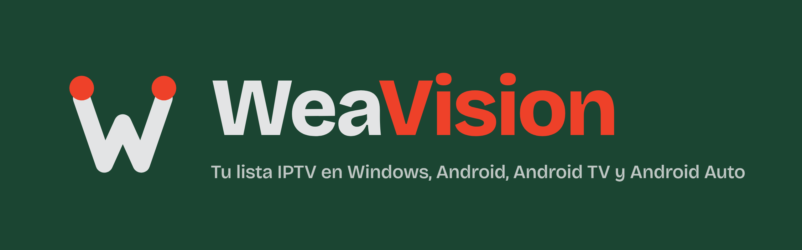
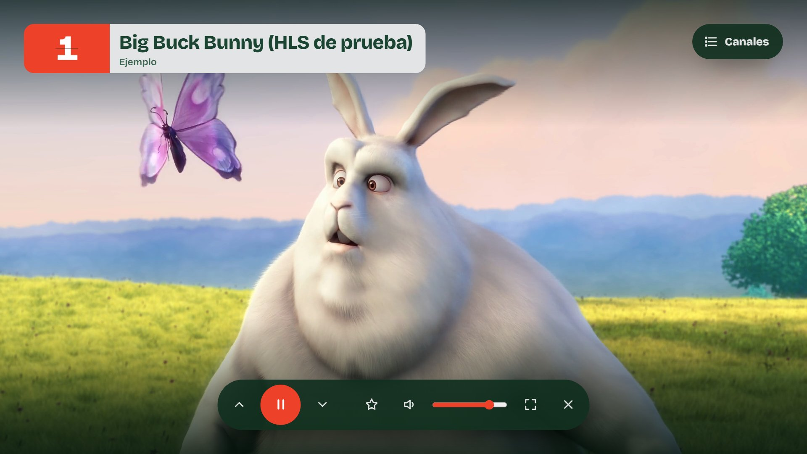
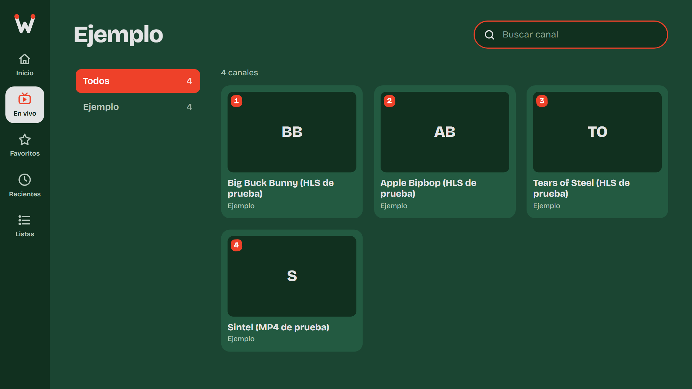
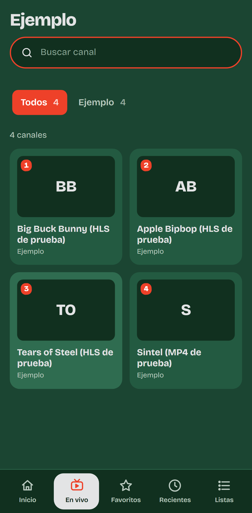

<p align="center">
  
</p>

<p align="center">
  <a href="https://github.com/Jaime-SC/WeaVision/actions/workflows/build.yml"></a>
  <a href="LICENSE"></a>
  
  <a href="https://github.com/Jaime-SC/WeaVision/releases/tag/latest-main"></a>
</p>

<p align="center">
  <b>Reproductor IPTV libre y de código abierto.</b> Carga tu lista M3U y mira tus canales en el PC, el teléfono, la tele o el auto.<br>
  Sin cuentas, sin publicidad y sin telemetría: todo se guarda en tu dispositivo.
</p>

<p align="center">
  <a href="#descargas"><b>Descargas</b></a> ·
  <a href="#qué-hace">Qué hace</a> ·
  <a href="#controles">Controles</a> ·
  <a href="#desarrollo">Desarrollo</a> ·
  <a href="#privacidad">Privacidad</a> ·
  <a href="#english">English</a>
</p>

<p align="center">
  
</p>

## Descargas

| Plataforma | Descarga | Notas |
|---|---|---|
| **Windows 10 / 11** (64 bits) | [**⬇ Instalador** `WeaVision-windows-setup.exe`](https://github.com/Jaime-SC/WeaVision/releases/download/latest-main/WeaVision-windows-setup.exe) | Asistente de instalación con acceso directo en el menú Inicio. |
| **Windows 10 / 11**, sin instalar | [**⬇ Portable** `WeaVision-windows-portable.zip`](https://github.com/Jaime-SC/WeaVision/releases/download/latest-main/WeaVision-windows-portable.zip) | Descomprime la carpeta y abre `WeaVision.exe`. |
| **Android** (teléfono y tablet) | [**⬇ APK** `WeaVision-android.apk`](https://github.com/Jaime-SC/WeaVision/releases/download/latest-main/WeaVision-android.apk) | Instalarlo encima de una versión anterior la actualiza. |
| **Android TV / Google TV** | El mismo [APK](https://github.com/Jaime-SC/WeaVision/releases/download/latest-main/WeaVision-android.apk) | Aparece en el launcher de la tele y se maneja entero con el control remoto. Ver [cómo instalarlo](#instalar-en-android-tv). |
| **Android Auto** | Incluido en el [APK](https://github.com/Jaime-SC/WeaVision/releases/download/latest-main/WeaVision-android.apk) | Audio de tus Favoritos y Recientes (ver [por qué solo audio](#android-auto)). |

Estos links apuntan siempre a la **última compilación de `main`**, que se regenera sola en cada cambio.
Las **versiones con número** quedan en [Releases](https://github.com/Jaime-SC/WeaVision/releases).

> [!NOTE]
> WeaVision **no incluye canales ni contenido**. Es un reproductor: tú cargas tu propia lista M3U, la que te entrega tu
> proveedor de TV o una lista pública y legal. Para probarlo sin lista, la app trae una de ejemplo con videos libres
> (Big Buck Bunny, Sintel, Tears of Steel).

> [!TIP]
> **¿Windows muestra "Windows protegió su PC"?** Los ejecutables aún no tienen firma digital, así que SmartScreen no
> reconoce al editor. Elige *Más información* → *Ejecutar de todas formas*. Si tienes activado el **Control Inteligente
> de Aplicaciones** de Windows 11, este no deja abrir apps sin firma: usa la versión de Android o la app en el navegador
> (`npm run dev`). Todo lo que se publica aquí lo compila GitHub Actions desde este mismo código.

### Instalar en Android TV

1. En la tele, activa **Instalar apps desconocidas** (Ajustes → Privacidad/Seguridad, o en Opciones de desarrollador).
2. Instala la app **Downloader** desde Google Play y abre este link:
   `https://github.com/Jaime-SC/WeaVision/releases/download/latest-main/WeaVision-android.apk`
3. O desde un PC con ADB: `adb install WeaVision-android.apk`

## Qué hace

<table>
  <tr>
    <td width="66%"></td>
    <td width="34%"></td>
  </tr>
</table>

- **Listas M3U / M3U Plus** desde un enlace o un archivo; varias listas a la vez, actualizar y eliminar.
- **Categorías** (`group-title`), **logos** (`tvg-logo`), **número de canal** (`tvg-chno`) y búsqueda sin tildes.
- **Favoritos, Recientes y "Seguir viendo"**, más un resumen de lo que viste en la semana.
- **Zapping** con ↑/↓ o CH+/CH− mientras ves un canal, y lista rápida de canales sin salir del video.
- **Formatos:** HLS (`.m3u8`), MPEG-TS (`.ts` o sin extensión) y MP4. Respeta `#EXTVLCOPT:http-user-agent` y `http-referrer`.
- **Se ve todo, como en VLC:** en Android decodifica ExoPlayer (Media3). En Windows, los canales en vivo pasan por un FFmpeg
  incluido que convierte al vuelo el audio MP2/AC-3/E-AC-3, agrega una pista muda a los canales sin audio y recodifica el video
  1080i que Chromium no acepta. La app recuerda qué necesita cada canal para que la próxima vez parta directo.
- **Privada:** sin cuentas ni servidores propios. Las listas, favoritos e historial quedan en tu dispositivo.

### Android Auto

Google no permite video en Android Auto a apps de terceros, así que en el auto WeaVision funciona como **radio de tus
canales**: muestra tus Favoritos y Recientes y reproduce su audio, con los controles del volante y de la pantalla del auto.

## Controles

| Acción | Control remoto | Teclado (Windows) |
|---|---|---|
| Moverse | Flechas | Flechas / Tab |
| Elegir / ver | OK | Enter |
| Volver / cerrar | Atrás | Esc |
| Eliminar una lista | Mantener OK | Mantener clic o Enter |
| Canal anterior / siguiente | ↑ / ↓ o CH+ / CH− | ↑ / ↓ o RePág / AvPág |
| Pausa | Play/Pausa | Espacio |
| Silenciar | — | M |
| Pantalla completa | — | F / F11 |
| Buscar | — | Ctrl+F |

## Desarrollo

Requisitos: **Node 22**. Para Android, además **JDK 21** y el Android SDK (o Android Studio).

```bash
npm install
npm run dev
```

| Comando | Qué hace |
|---|---|
| `npm run dev` | App en el navegador con recarga en vivo |
| `npm test` | Pruebas unitarias (Vitest) |
| `npm run test:e2e` | Pruebas de interfaz con Playwright (vista TV y teléfono) |
| `npm run electron` | Abre la versión de escritorio |
| `npm run dist:win` | Genera el instalador y el zip de Windows en `release/` (ejecutar en Windows) |
| `npm run android:apk` | Genera el APK en `android/app/build/outputs/apk/debug/` |
| `node scripts/icons.mjs` | Regenera los íconos (Android, TV, Windows) desde `public/brand.svg` |
| `node scripts/readme-assets.mjs` | Regenera el banner y las capturas de este README (con `npx vite preview` corriendo) |

Cada push compila y prueba todo en GitHub Actions ([`build.yml`](.github/workflows/build.yml)) y actualiza los links de
descarga de arriba. Una versión nueva se publica con un tag: `git tag v2.0.0 && git push origin v2.0.0`.

### Arquitectura

```
src/            UI y lógica compartida (TypeScript + Vite)
  core/         parser M3U, almacenamiento (IndexedDB), estado
  player/       reproductor: hls.js / mpegts.js en web y Windows, plugin nativo en Android
  ui/           íconos, animaciones y navegación espacial para el control remoto
electron/       app de Windows:
  main.cjs          ventana, cabeceras de red tipo reproductor (sin CORS)
  ffmpeg-proxy.cjs  relé FFmpeg local para los formatos que Chromium no decodifica
android/        proyecto Capacitor + código nativo:
  WeaPlayerPlugin   ExoPlayer dibujado bajo el WebView transparente
  PlaybackService   sesión Media3: notificación, pantalla de bloqueo y Android Auto
design/logo/    logo "W antena" y su guía de uso (GUIDELINES.md)
```

### Animaciones y componentes

| Librería | Dónde |
|---|---|
| [anime.js](https://animejs.com/) | El logo se dibuja solo; la etiqueta del canal "cae" en cada zapping; las antenas buscan señal mientras sintoniza |
| [Motion](https://motion.dev/) | Transiciones entre secciones, aparición de canales, barra del reproductor, indicador del menú |
| [KokonutUI](https://kokonutui.com/) (MIT) | Portados sin React: *Split Flap Text*, *Smooth Tab*, *Hold Button*, *Promise Toast* |
| [Bklit UI](https://bklit.com/) (MIT) | Portados sin React: gráfico "Tu semana" y texto con brillo de "Sintonizando…" |

Todo respeta la opción del sistema de reducir movimiento.

## Privacidad

Este programa no transfiere información a otros sistemas en red, salvo cuando el usuario lo pide
(las listas y canales que él mismo agrega, y los logos que esas listas indican). No hay estadísticas, telemetría ni
publicidad.

## English

**WeaVision** is a free, open source (MIT) IPTV player: one app for **Windows**, **Android**, **Android TV** and
**Android Auto**. Load your own M3U playlist and watch live channels with favorites, history, channel zapping and full
remote-control navigation. It ships no channels or content. On Windows it bundles FFmpeg, like VLC, to play streams whose
audio or video Chromium cannot decode. No accounts, ads or telemetry.

Downloads are in the [table above](#descargas) (Windows installer, Windows portable zip, Android/Android TV APK).
The Windows executables are not code signed yet, so SmartScreen may warn on first run (click *More info → Run anyway*).
Every file is built by GitHub Actions from this public repository.

## Licencia

[MIT](LICENSE) © [Jaime Arturo Sánchez Cerda](https://github.com/Jaime-SC) · Hecho con cariño por LosCareWea.
Componentes de terceros y sus licencias (incluido FFmpeg, GPL v3, en la versión de Windows) en
[THIRD_PARTY_NOTICES.md](THIRD_PARTY_NOTICES.md).
